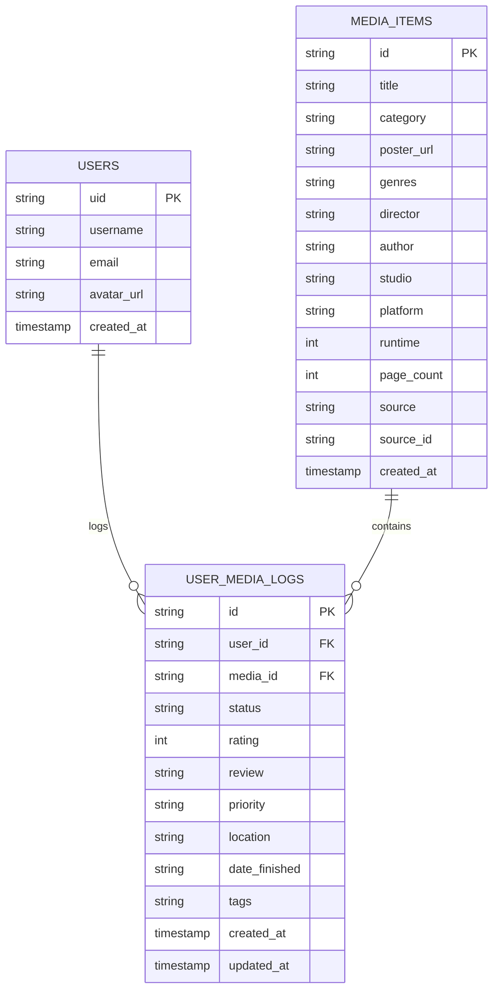

# 🚀 Media Tracker: Multi-User & Multi-Platform Expansion Plan (Firebase Edition)

This document outlines the architectural blueprint, database evolution, platform roadmap, and infrastructure cost breakdown to evolve **Media Tracker** from a single-user offline desktop app into a shared, multi-user system for 10–20 collaborative users across **Desktop (Windows/Linux)**, **Web (Browser)**, and **Mobile (Android)** using **Google Firebase**.

---

## 1. Executive Summary & Codebase Reuse

| Metric | Details |
| :--- | :--- |
| **Target Audience** | 10–20 collaborative users / friends sharing reviews & libraries |
| **Backend & Cloud** | **Google Firebase** (Cloud Firestore, Firebase Auth, Cloud Storage, Firebase Hosting) |
| **Code Reuse Rate** | **~85% of existing code** (Zero UI rewrite required) |
| **Reusable Layers** | React 19 UI components, Tailwind CSS v4 design system, filtering/sorting/grouping algorithms, TMDB/AniList/Google Books metadata clients |
| **Core Shift** | Replace local SQLite IPC (`window.electronAPI.invoke`) with a unified Firebase Client SDK (`firebase/firestore`, `firebase/auth`) |
| **Estimated Hosting Cost** | **$0.00 / month** (100% covered by Firebase Spark Free Tier) |

---

## 2. Why Firebase over Supabase

Firebase offers significantly higher free-tier thresholds and built-in offline caching ideal for Media Tracker:

| Feature | **Firebase (Spark Free Tier)** | **Supabase (Free Tier)** | Advantage for Media Tracker |
| :--- | :--- | :--- | :--- |
| **Database Operations** | **50,000 reads / 20,000 writes / day** | Fixed 500 MB DB capacity | Plenty of headroom for 10–20 friends logging daily |
| **Cloud File Storage** | **5 GB Storage** | 1 GB Storage | **5x larger storage** for cached covers & avatars |
| **Storage Bandwidth** | 1 GB / day download | 2 GB / month download | ~15x higher download allowance |
| **Authentication** | **50,000 Monthly Active Users (MAU)** | 50,000 MAU | Identical, seamless Google & Email auth |
| **Offline Persistence** | **Built-in IndexedDB / Cache support** | Requires manual third-party state sync | Seamless offline-first experience across Web, Desktop & Mobile |
| **Realtime Updates** | Realtime Document Listeners (`onSnapshot`) | Realtime Websockets | Friends see updates instantly without polling |

---

## 3. Database Architecture (Cloud Firestore)

Firestore is a scalable NoSQL document database. We normalize the data into 3 primary collections to enable shared media metadata, personal ratings, and friendship activity feeds:



### Collection Details

1. **`users` Collection** (`/users/{uid}`):
   - Stores user profiles, display names, and avatars.
2. **`media_items` Collection** (`/media_items/{mediaId}`):
   - Global media repository. If 5 friends watch *Dune: Part Two*, the metadata, runtime, and poster are stored only once.
   - Identified by `source_id` (e.g. `tmdb_693134`, `anilist_154587`, `book_vX0yAAAAMAAJ`).
3. **`user_media_logs` Collection** (`/user_media_logs/{logId}`):
   - Individual user consumption records.
   - Stores personal status (`Consuming`, `To Consume`, `Consumed`), rating (0–10), review, priority, location, and tags.
   - Powers personal libraries, community average ratings, and social feeds.

---

## 4. Multi-Platform System Architecture

```mermaid
graph TD
    subgraph Frontend Clients
        Web[Web App - Browser]
        Desktop[Desktop App - Electron]
        Android[Android App - Capacitor/PWA]
    end

    subgraph Firebase Client SDK
        AuthSDK[Firebase Auth - Email/Google]
        FirestoreSDK[Firestore SDK - Offline Cache & Realtime]
        StorageSDK[Cloud Storage SDK - 5GB Covers]
    end

    subgraph External Metadata APIs
        TMDB[The Movie Database]
        AniList[AniList GraphQL]
        GoogleBooks[Google Books API]
    end

    Web --> AuthSDK
    Web --> FirestoreSDK
    Desktop --> AuthSDK
    Desktop --> FirestoreSDK
    Android --> AuthSDK
    Android --> FirestoreSDK

    FirestoreSDK --> StorageSDK
    Frontend Clients --> ExternalMetadataAPIs
```

### 4.1 Target 1: Web Application (Browser)
- **Deployment**: Deploy the React 19 + Vite bundle directly to **Firebase Hosting** with 1-click CI/CD (`firebase deploy`).
- **Access**: Instant access via custom domain (`https://mediatracker.web.app`) on both desktop and mobile browsers.

### 4.2 Target 2: Desktop Application (Windows & Linux)
- **Framework**: Electron remains the desktop container.
- **Offline Sync**: Leverages Firestore's native client caching to ensure full functionality even when offline, syncing automatically once connection is re-established.
- **Packaging**: `electron-builder` builds native Windows `.exe` installers and Linux `.deb`/`AppImage` binaries.

### 4.3 Target 3: Android Application (Capacitor / PWA)
- **Capacitor Integration**: Initialize `@capacitor/core` and `@capacitor/android` over the Vite distribution.
- **Packaging**: Compiles directly into native Android `.apk` files without rewriting any React UI.
- **Alternative (PWA)**: Register a Service Worker and `manifest.json` for 1-click installation from mobile browsers.

---

## 5. Security Rules (Firestore & Storage)

```javascript
rules_version = '2';
service cloud.firestore {
  match /databases/{database}/documents {
    // Media Items: Anyone logged in can read; authenticated users can add new items
    match /media_items/{mediaId} {
      allow read: if request.auth != null;
      allow create: if request.auth != null;
      allow update, delete: if false; // Immutable global catalog
    }

    // User Media Logs: Anyone logged in can read reviews; users can only edit their own
    match /user_media_logs/{logId} {
      allow read: if request.auth != null;
      allow create, update, delete: if request.auth != null && request.auth.uid == request.resource.data.user_id;
    }

    // User Profiles: Public read for collaborative friends; editable only by owner
    match /users/{userId} {
      allow read: if request.auth != null;
      allow write: if request.auth != null && request.auth.uid == userId;
    }
  }
}
```

---

## 6. Implementation Roadmap

### Phase 1: Firebase Project & SDK Setup
1. Create a Firebase project in the [Firebase Console](https://console.firebase.google.com/).
2. Enable **Firestore Database**, **Firebase Authentication** (Email/Password & Google Sign-In), and **Firebase Storage**.
3. Deploy the Firestore security rules.

### Phase 2: Unified API Service Abstraction
1. Create `src/services/firebase.ts` and `src/services/mediaService.ts`.
2. Abstract CRUD operations:
   - `getLibrary(userId, status)`
   - `addMediaLog(item, logData)`
   - `updateMediaLog(logId, data)`
   - `getFriendsFeed()`
   - `getCommunityRating(mediaId)`
3. Switch React components from Electron IPC calls to `mediaService`.

### Phase 3: Auth & Collaborative Social Features
1. Add Login and Register modal / screen.
2. Add a **"Friends / Activity Feed"** tab showing recent completions, reviews, and ratings from other group members.
3. Show aggregate community ratings on media cards (e.g., *Group Avg: 8.6/10*).

### Phase 4: Multi-Platform Deployment
1. Deploy Web App to **Firebase Hosting** (`firebase deploy`).
2. Package Android `.apk` with Capacitor (`npx cap add android && npx cap open android`).
3. Package Windows `.exe` desktop application (`npm run make`).
